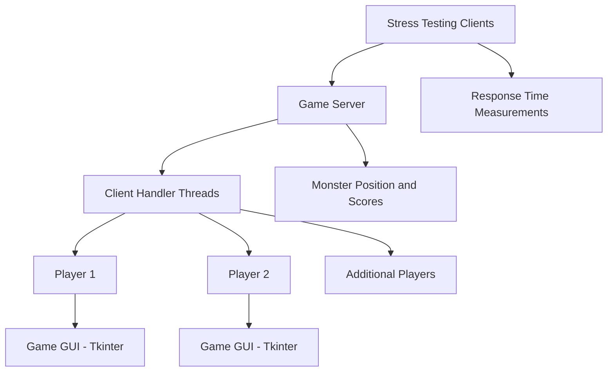

# Proyecto Alpha — Distributed Multiplayer Game

## Overview

Proyecto Alpha is a Python-based multiplayer game developed to explore **distributed systems, TCP client-server communication, concurrent programming, and performance testing**.

The application implements a simple game in which multiple clients attempt to hit a randomly positioned monster on a 3×3 grid. A central server manages player connections, updates scores, validates hits, and determines when a player reaches the winning threshold.

The project also includes a stress-testing client that simulates multiple players sending requests to the server and collects response-time measurements to evaluate its behavior under concurrent activity.

## Key Features

- **Client-server architecture:** A central server coordinates game logic and processes requests from connected clients.
- **TCP socket communication:** Clients and the server exchange messages over TCP connections.
- **Concurrent connection handling:** Python threads allow the server to handle multiple client connections concurrently.
- **Multiplayer game logic:** Players select grid positions to attempt to hit a randomly positioned monster.
- **Score tracking:** The server maintains individual player scores and declares a winner after five successful hits.
- **Graphical user interface:** Tkinter provides a 3×3 grid of buttons for player interactions.
- **Stress testing:** Multiple automated clients generate requests for a configurable duration.
- **Performance metrics:** The stress-testing component records response times and calculates the average and standard deviation.

## Technologies

- **Python** — application logic and server/client implementation.
- **Socket Programming** — TCP network communication.
- **Threading** — concurrent client handling and parallel stress-test execution.
- **Tkinter** — graphical user interface.
- **Random** — randomized monster positions and automated test inputs.
- **Statistics** — calculation of response-time variability.

## Architecture



The server acts as the central authority for the game. Clients send their selected grid positions, and the server compares each selection against the current monster position. Responses indicate whether the attempt was successful or unsuccessful.

The stress-testing component generates additional client connections and repeated requests to observe server response times under simulated concurrent activity.

## How It Works

### 1. Server

The server listens for incoming TCP connections on port `5555` by default. Each accepted connection is handled in a separate thread.

Its responsibilities include:

- Registering connected players.
- Generating a random monster position within the nine-cell grid.
- Processing player hit requests.
- Updating scores and sending feedback to clients.
- Declaring a winner after five successful hits.
- Resetting scores after a winning event.

### 2. Game Client

The client connects to the server and registers a player name. Its graphical interface displays nine buttons corresponding to the cells in the grid.

When a player selects a cell, the client sends a `HIT` message containing the selected position. The server responds with messages such as `ACIERTO`, `FALLO`, `WINNER`, or `RESET`.

### 3. Stress Testing

The stress-testing mode creates a configurable number of automated clients. Each client repeatedly sends randomly selected positions during a specified time interval.

The application records successful response-time measurements and calculates:

- **Average response time:** The mean time between sending a request and receiving a response.
- **Standard deviation:** A measure of variability in the recorded response times.

These metrics provide a starting point for examining application responsiveness under simulated load.

## Getting Started

### Prerequisites

- Python 3.
- Tkinter, usually included with standard Python installations.
- A terminal or command prompt.
- Multiple terminal sessions to run the server and clients.

The application uses Python standard-library modules, so no additional third-party packages are required for the code shown.

### Run the Application

Clone the repository:

```bash
git clone https://github.com/jman0306/Proyecto-Alpha-Sistemas-Distribuidos.git
cd Proyecto-Alpha-Sistemas-Distribuidos
```

Run the Python script containing the server, client, and stress-testing implementation:

```bash
python <script_name>.py
```

Replace `<script_name>.py` with the actual filename.

### Start the Server

Choose the server option when prompted:

```text
s
```

Keep the server running while starting clients.

### Start a Game Client

Run the script in another terminal and choose:

```text
c
```

Enter a player name and use the graphical grid to select positions.

### Run a Stress Test

Run the script in another terminal and choose:

```text
e
```

Enter the number of stress-testing clients and the duration of the test in seconds.

The application will report the average response time and standard deviation for the measurements collected.

## Skills Demonstrated

- Distributed application design.
- TCP socket programming.
- Concurrent programming with threads.
- Client-server protocol design.
- Shared game-state management.
- Graphical interface development.
- Load simulation and response-time analysis.
- Basic performance measurement and statistical analysis.

## Limitations and Future Improvements

Potential improvements include:

- Using explicit message framing to handle TCP's stream-based communication reliably.
- Adding synchronization locks for shared server state, including scores and player connections.
- Separating the game server, graphical client, and stress-testing tools into different modules.
- Handling disconnections and malformed requests more robustly.
- Improving the stress-testing client so it does not compete with the game client's response-reading thread.
- Reporting additional performance metrics, such as median and percentile response times, request throughput, and timeout rate.
- Allowing configuration of the server host and port for testing across multiple machines.

## Author

**Juan Manuel Ambriz Nuñez**

- GitHub: [jman0306](https://github.com/jman0306)

